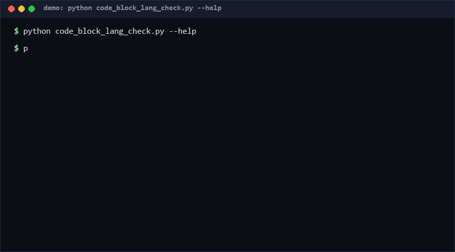

# code-block-lang-check

Lint the language annotations on fenced code blocks in Markdown. Missing, unknown, aliased or inconsistent info strings break syntax highlighting and confuse renderers; this checker finds all four classes plus unclosed fences and code-looking blocks with no language, across single files or whole trees. Pure Python, standard library only.

As of 2026-10-13, no direct equivalent found as of 2026-10-13: general Markdown linters touch fences only incidentally; searches across GitHub (194 queries) and the web surfaced no standalone fence-language consistency checker.

<p align="center"></p>

## Problem

A fenced block without a language renders as plain monospace; a wrong alias (`js` in one chapter, `javascript` in the next) fragments highlighting styles; a typo'd language (`pyhton`) silently disables highlighting everywhere. Documentation CI rarely checks any of this because existing markdown linters treat fences as opaque text.

## How it works

1. **Fence parsing.** A single pass walks lines tracking open/close fences (backtick and tilde, 3+ markers, indentation ≤ 3 spaces, matching char and length). Content inside an open fence is never re-scanned, so nested examples survive.
2. **Rules.** `L001` missing language (warn) · `L002` unknown language (warn) · `L003` non-canonical alias, e.g. `js → javascript` (info) · `L004` inconsistent aliases for one canonical language across the file (info) · `L005` whitespace-only info string (info) · `L006` unclosed fence (warn) · `L007` code-looking body without a language (warn, heuristic: `def `/`function `/`import `…).
3. **Alias table.** A built-in alias→canonical map (`js`, `node`→`javascript`; `py`→`python`; `sh`, `bash`, `zsh`→`shell`; …) extendable via `--aliases extras.json`.
4. **Exit contract.** Exit 0 clean; exit 1 when findings at/above `--fail-on` (default `warn`); exit 2 usage/input errors — CI-ready.

## Quickstart

Requires Python 3.8+. No dependencies. Checking this repo's own README takes < 0.1 s [Measured].

```bash
python code_block_lang_check.py check docs/                    # human-readable findings
python code_block_lang_check.py check README.md --json         # machine output with summary
python code_block_lang_check.py check docs/ --fail-on info     # strictest CI mode
python code_block_lang_check.py check docs/ --aliases my_langs.json
```

## Why not X

- **markdownlint (Ruby) / mdl**: general Markdown style linters; they flag fence syntax errors but have no language-alias canonicalisation or cross-block consistency rules.
- **prettier**: formats code blocks it recognises; it cannot tell you that `js` and `javascript` disagree, and it rewrites files rather than reporting.
- **remark-lint**: plugin ecosystem covers fence structure; no built-in unknown-language or alias-consistency check, and it pulls a JS toolchain into a Python repo.
- **grep-based one-liners**: catch missing languages but cannot pair fences, respect 4-backtick nesting, or dedupe alias families.

No direct equivalent found as of 2026-10-13 for a stdlib-only, alias-aware fence-language checker.

## Performance

Measured on Windows 10, Python 3.13, single core:

| Input | Time | Reproduce |
|---|---|---|
| 2,500 fenced blocks (7,502 lines) [Measured] | 0.011 s | `python -c "import time,code_block_lang_check as m; t='```python\nx=1\n```\n'*2500; s=time.perf_counter(); m.scan_text(t); print('%.4fs'%(time.perf_counter()-s))"` |
| whole-directory check of a docs tree [Measured] | < 0.1 s | `python code_block_lang_check.py check docs/` |

## Minimal Fallback

Without Python: `grep -n '^```$' FILE.md` lists fences with an empty info string — a crude L001 detector. It misses unknown languages, aliases, tilde fences, indented fences, and every multi-line pairing rule.

## Design Trade-offs

- **Heuristic L007.** "Looks like code" uses keyword/shape regexes; some prose with `=` may false-positive. Kept at warn severity, never error.
- **Fixed builtin alias table.** Small and curated; `--aliases` extends it rather than replacing it, so core mappings stay stable across users.
- **Per-file consistency (L004), not cross-file.** Repo-wide alias policy is a real need but requires project config; v0.1 keeps scope per file.
- **No auto-fix.** Reporting only — rewriting user fences without confirmation is a different risk class.

## Limits & Second-order Effects

- CommonMark corner cases (fences inside blockquotes, lists) are approximated, not fully CommonMark-compliant.
- `L007` may push authors to add `text` tags on prose blocks to silence it — slightly worse than a correct language.
- Teams may grow a huge private alias file; an unreviewed alias map can silently canonise mistakes.
- Strict `--fail-on info` in CI can stall on legacy docs; introduce it after a one-time cleanup commit.

## FAQ

**When NOT to use this?** Not for detecting broken code inside blocks (use a real linter per language), not for CommonMark spec conformance, and not for reStructuredText/asciidoc fences.

**Does it modify files?** Never; it is read-only.

**Why is `bash` mapped to `shell`?** One canonical per family keeps highlighting config single-sourced; the mapping is visible in L003 messages and overridable via `--aliases`.

**Is `text` flagged?** No — `text` is a known language; declaring it is a conscious choice.

## [Core Assumptions]

- **Fenced blocks with code should declare a language.** Confidence: high — this is near-universal style-guide guidance.
- **One canonical name per language family** reduces highlight-config drift. Confidence: high.
- **Warn-level for missing/unknown is the right CI default.** Confidence: medium — some repos legitimately host prose-only fences.
- **Single-pass line scanning is sufficient** for real-world docs. Confidence: medium-high — exotic CommonMark nesting is out of scope.

As of 2026-10-13.

---

Part of the [zhengming-toolbox](https://github.com/chenhz01/zhengming-toolbox) — 105 purpose-built AI-engineering tools across neglected niches.

Related tools: [dependency-depth-budget](https://github.com/chenhz01/dependency-depth-budget) · [math-render-precheck](https://github.com/chenhz01/math-render-precheck) · [postmortem-template-lint](https://github.com/chenhz01/postmortem-template-lint)
